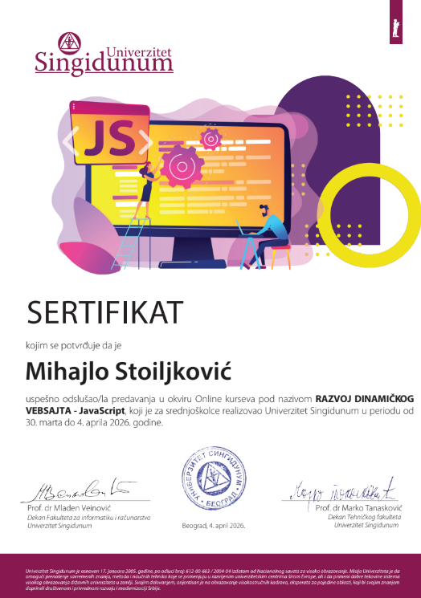

<div align="center">


# 🎬 FilmexTip 2026

[](https://mihajlos07.github.io)
[](./LICENSE)


### 🌍 Jezik

[🇬🇧 English](./README.md) &nbsp;|&nbsp; **🇷🇸 Srpski**

</div>

---

<div align="center">

**Dinamički veb-sajt za pretragu i pregled filmova, napravljen u okviru kursa Univerziteta Singidunum**
*„Razvoj dinamičkog vebsajta – JavaScript"*

</div>

## 📖 O projektu

**FilmexTip** je dinamička web aplikacija koja u realnom vremenu učitava filmove sa eksternog REST API-ja i prikazuje ih u obliku responzivnih kartica. Korisnik može da pretražuje filmove, otvori stranicu sa detaljima svakog filma i da po želji prebacuje sajt između **svetle** i **tamne** teme.

Projekat je nastao kao praktični deo besplatnog online kursa **„Razvoj dinamičkog vebsajta – JavaScript"** koji je **Univerzitet Singidunum** realizovao za srednjoškolce, i prikazuje ključne koncepte modernog front-end razvoja bez ijednog framework-a — čist (vanilla) JavaScript.

> ℹ️ Ovo je samostalno rađen projekat u okviru kursa, a ne kopija tuđeg rešenja.

## ✨ Funkcionalnosti

| | Funkcionalnost | Opis |
|---|---|---|
| 🎞️ | **Dinamičko učitavanje filmova** | Podaci se preuzimaju sa REST API-ja pomoću `fetch()` i prikazuju bez osvežavanja stranice |
| 🔍 | **Pretraga** | Pretraga dugmetom *Search* ili automatski dok kucate |
| ⏱️ | **Debounce pretraga** | Upit se šalje tek 600 ms nakon poslednjeg unetog karaktera, čime se izbegava nepotrebno opterećenje API-ja |
| 🃏 | **Kartice iz HTML `<template>`-a** | Svaki film se generiše kloniranjem šablona (`cloneNode`) |
| 📄 | **Stranica sa detaljima** | Poster, naslov, originalni naslov, režiser, trajanje, datum izlaska, žanrovi, glumci i opis |
| 🔗 | **Prosleđivanje parametara kroz URL** | Detalji se učitavaju na osnovu `?p=<shortUrl>` pomoću `URLSearchParams` |
| 🌗 | **Svetla / tamna tema** | Izbor se pamti u `localStorage`, pa ostaje sačuvan i nakon zatvaranja pregledača |
| ⏳ | **Loading indikatori** | Bootstrap *spinner-grow* animacija tokom čekanja podataka |
| 📱 | **Responzivan dizajn** | Prilagođen telefonima, tabletima i računarima zahvaljujući Bootstrap grid sistemu |
| 🗂️ | **Accordion i navigacija** | Informacije o projektu na početnoj, kolapsibilni navbar i stranica „O nama" |

## 🛠️ Korišćene tehnologije

- **HTML5** – semantička struktura stranica i `<template>` element
- **CSS3** – dodatno stilizovanje preko `css/styles.css`
- **JavaScript (ES6+)** – `fetch`, Promises, arrow funkcije, template literali, DOM manipulacija, `localStorage`, `URLSearchParams`
- **[Bootstrap 5.3](https://getbootstrap.com/docs/5.3/getting-started/introduction/)** – grid, kartice, navbar, accordion, spinneri, ugrađena podrška za dark mode (`data-bs-theme`)
- **[Font Awesome 7](https://fontawesome.com/)** – ikonice
- **[Movie Cache API](https://github.com/Pequla/express-movie-cache)** – izvor podataka o filmovima (`https://movie.pequla.com/api/movie`)

## 📁 Struktura projekta

```
MIhajloS07.github.io/
├── index.html        # Početna strana – lista filmova i pretraga
├── details.html      # Detalji izabranog filma
├── about.html        # O projektu i kursu
├── css/
│   └── styles.css    # Prilagođeni stilovi
├── js/
│   ├── main.js       # Učitavanje filmova, pretraga, debounce, prekidač teme
│   ├── details.js    # Učitavanje i prikaz detalja filma, formatiranje datuma i trajanja
│   └── theme.js      # Primena sačuvane teme pri učitavanju stranice
├── img/
│   ├── movieicon.png          # Favicon
│   ├── singidunum-logo.png    # Logo Univerziteta Singidunum
│   └── sertifikat.png         # Sertifikat o završenom kursu
├── LICENSE
└── README.md
```

## 🔌 Korišćeni API endpointi

| Metoda | Endpoint | Namena |
|---|---|---|
| `GET` | `https://movie.pequla.com/api/movie?search={upit}` | Lista filmova (sa opcionom pretragom) |
| `GET` | `https://movie.pequla.com/api/movie/short/{shortUrl}` | Detalji jednog filma |

## 🚀 Pokretanje lokalno

Projekat je potpuno statičan, tako da nije potrebna instalacija ni build proces.

```bash
# 1. Kloniraj repozitorijum
git clone https://github.com/MIhajloS07/MIhajloS07.github.io.git

# 2. Uđi u folder
cd MIhajloS07.github.io

# 3. Otvori index.html u pregledaču
#    (ili pokreni lokalni server, npr. uz VS Code ekstenziju "Live Server")
```

Potrebna je internet konekcija jer se Bootstrap, Font Awesome i podaci o filmovima učitavaju sa spoljnih servera.

## 🎓 O kursu

<div align="center">


</div>

| | |
|---|---|
| **Naziv kursa** | Razvoj dinamičkog vebsajta – JavaScript |
| **Organizator** | Univerzitet Singidunum, Beograd |
| **Ciljna grupa** | Učenici srednjih škola |
| **Format** | Online kurs |
| **Period održavanja** | 30. mart – 4. april 2026. |
| **Polaznik** | Mihajlo Stoiljković |

Tokom kursa obrađeni su osnovi JavaScript-a, rad sa DOM-om, asinhrono programiranje i komunikacija sa REST API-jem, a znanje je primenjeno kroz izradu ovog projekta.

🔗 [Vest o kursu na sajtu Univerziteta Singidunum](https://nis.singidunum.ac.rs/news/besplatan-online-kurs-javascript-2026)

### 🏅 Sertifikat

<div align="center">



*Sertifikat o uspešno završenom online kursu, Beograd, 4. april 2026.*

</div>

## 🔮 Moguća unapređenja

- [ ] Obrada grešaka (`.catch()`) i poruka kada nema rezultata pretrage
- [ ] Sakrivanje spinnera nakon učitavanja filmova
- [ ] Filtriranje po žanru i sortiranje
- [ ] Lista omiljenih filmova sačuvana u `localStorage`
- [ ] Paginacija ili *infinite scroll*
- [ ] Prelazak na `async/await` sintaksu

## 👨‍💻 Autor

**Mihajlo Stoiljković**
Učenik IV razreda, obrazovni profil *Elektrotehničar računara*

[](https://github.com/MIhajloS07)

## 📄 Licenca

Projekat je objavljen pod **MIT licencom** – detalji se nalaze u fajlu [LICENSE](./LICENSE).

---

<div align="center">

⭐ Ako ti se projekat sviđa, ostavi zvezdicu! ⭐

[🇬🇧 Switch to English](./README.md)

</div>
